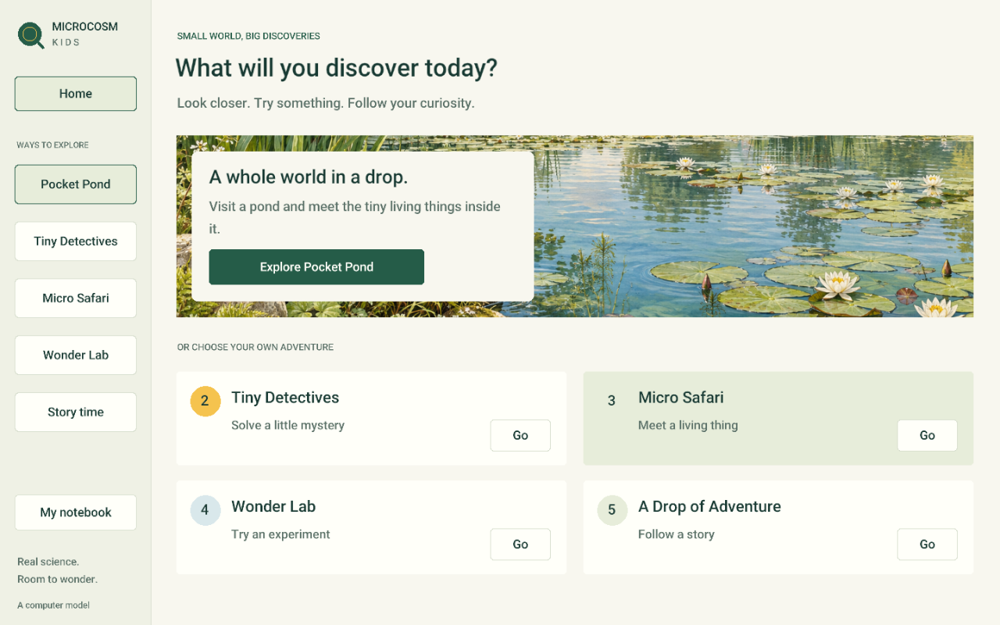

# Open Microcosm Kids

A native microscope adventure for curious children aged 6–10, built on
[Xooter's Open Microcosm](https://github.com/Xooter/Open-Microcosm).
Real simulated cells swim, feed and respond to their surroundings. A new
interface makes room to look, listen, ask questions and try things.



Development preview: all five experiences run, but the complete biology suite
is not green. See the [review evidence and remaining work](docs/design/kids-review.md).

## Five ways to explore

- **Pocket Pond:** choose a pond, puddle or moss habitat, tap living things,
  add life and save discoveries.
- **Tiny Detectives:** compare two swimmers and investigate which uses cilia.
- **Micro Safari:** meet Paramecium, Amoeba, Euglena and Volvox, with short
  explanations and an optional deeper layer.
- **Wonder Lab:** make a prediction, add salt to onion cells, compare with a
  captured baseline, then return to fresh water or start again.
- **A Drop of Adventure:** follow a Paramecium through three short story
  chapters, then explore on your own.

All five share pause, zoom, a labelled diagram view, optional local read-aloud,
and a photo notebook with full-size viewing, saved on your own computer. There are no accounts,
advertisements, points or cloud speech requests.

This is a computer model, not a view through a physical microscope. Habitat
samples are curated, and some processes use accelerated biological time.
The interface explains these distinctions. Nematodes and other complete
multicellular animals are not currently simulated.

## Build and run on Linux

The original C++20 engine and raylib renderer are reused. No additional linked
library is required. Standard requirements: a C++20 compiler, OpenMP, CMake
3.24+, Ninja, Git, OpenGL 4.3 and X11 development headers. On Ubuntu/Mint:

```sh
sudo apt install build-essential cmake ninja-build git \
  libx11-dev libxrandr-dev libxinerama-dev libxcursor-dev libxi-dev libgl1-mesa-dev
./tools/build_kids_linux.sh
./build/release/microcosm_kids
```

If you cannot install development packages, the helper can extract headers
locally on an x86-64 Ubuntu/Mint machine that already has the runtime libraries:

```sh
./tools/build_kids_linux.sh --local-headers
```

This downloads APT development packages into ignored `build/` directories;
it does not install system packages or require sudo. CMake downloads the
existing pinned upstream libraries on the first build.

To install a separate application-menu entry for your user after building:

```sh
bash tools/install_kids_linux.sh
~/.local/bin/open-microcosm-kids
```

The installer places versioned copies in `~/.local/opt/open-microcosm-kids`
and switches its `current` symlink. It preserves existing launcher files.
It does not require sudo or replace the original laboratory.

The original research application is retained as target `microcosm`:

```sh
cmake --build --preset release --target microcosm
./build/release/microcosm
```

## Controls and saved discoveries

Click an organism to inspect it. Scroll or use +/- to zoom; right/middle drag
moves the view. Space pauses a live sample. Tab and Enter navigate buttons.
Esc stops narration. The experiment locks its camera during comparison.

On Linux, optional narration uses the existing local Speech Dispatcher service.
If it is unavailable, the same explanation remains on screen. Only Linux has been run and reviewed; ports to other platforms remain untested. The native interface does not yet expose a
full screen-reader accessibility tree.

The kids notebook lives in `~/.local/share/open-microcosm-kids`, separately from
the original laboratory profile. Photos include the engine's scale and
provenance sidecars. Set `MICROCOSM_KIDS_DATA=/some/folder` for an isolated profile.

## Review and verification

```sh
./build/release/microcosm_kids_tests
cmake --build --preset release
ctest --test-dir build/release -L rapidos --output-on-failure
```

For repeatable screenshots:

```sh
./build/release/microcosm_kids --experience 2 --screenshot /absolute/path/safari.png
```

Experience indices are 0–4 in the order above. Omit `--experience` for the home
screen. F10 saves a full-interface screenshot and state JSON in the profile's
`screenshots/` directory. Set `MICROCOSM_KIDS_QA_DIR` to redirect review captures.
The native input review scripts in `tools/qa_kids_*.py` use `xdotool` and an
already-running application; they are development tools, not runtime dependencies.

Read the [interface mechanics and scientific limits](docs/mechanics/kids-interface.md)
and the upstream [biological validation](docs/validation/README.md).
External child usability studies and independent biologist review have not been
performed; screenshots and engine tests do not establish those claims.

## Credits and licence

GPL-3.0-or-later. The simulation and original laboratory are by the
[Open Microcosm contributors](https://github.com/Xooter/Open-Microcosm).
Their source, scientific references, documentation and third-party licences are
preserved in this fork. The new kids interface lives in `src/kids/`.
Habitat illustration provenance is in [assets/kids](assets/kids/README.md).
