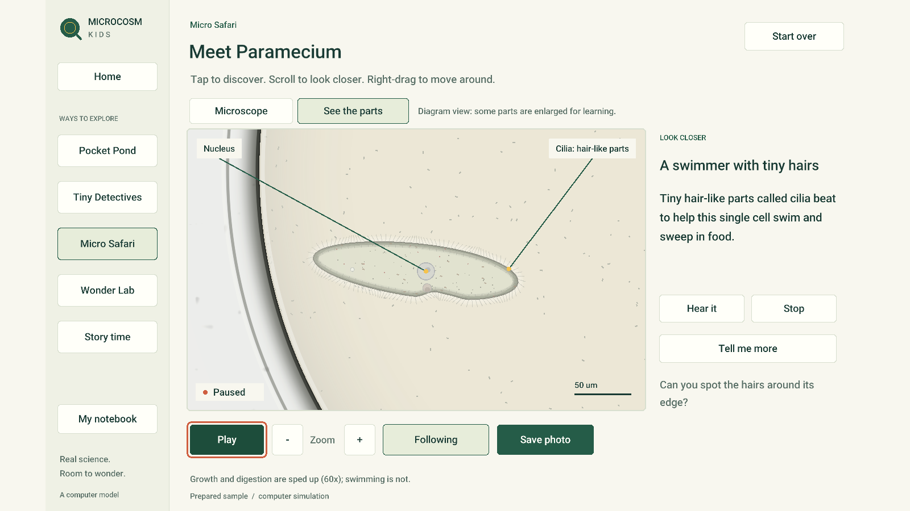
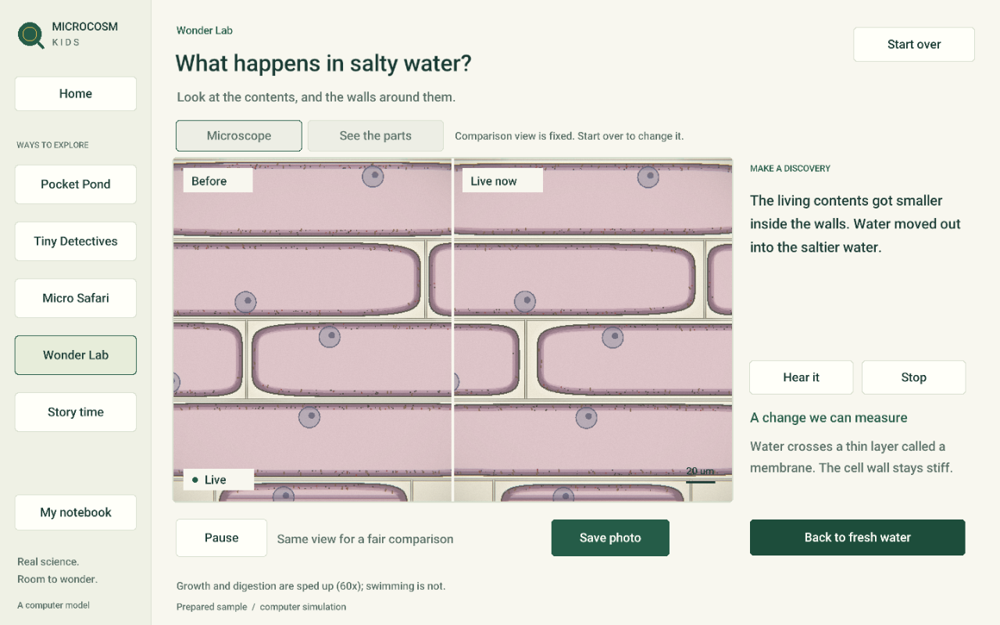

# Kids interface review

Status: development preview, 23 October 2026. All five journeys are implemented
and have been exercised in the native application. Completion is not yet claimed:
the full upstream biological suite is still running and has reported failures.
There has been no independent child usability study or external biologist review.

## Scope and evidence

The new `microcosm_kids` executable shares the upstream `biosim` library and
microscope renderer. The original research application remains available.
The habitat illustrations are decoration; every live viewport below comes from
the engine. These are native F10 captures, not generated interface mockups.
Each image has a neighbouring JSON state capture in `docs/img/kids/`.

| Experience | Native journey checked | Screenshot |
|---|---|---|
| Pocket Pond | Choose moss, inspect, pause, diagram, save discovery | [Habitats](../img/kids/habitats.png) |
| Tiny Detectives | Select both swimmers, compare their movement parts, answer and look again | [Detectives](../img/kids/detectives.png) |
| Micro Safari | Select Paramecium and Amoeba, follow, explain parts, offer real algal prey | [Safari](../img/kids/safari.png) |
| Wonder Lab | Predict, capture baseline, add salt, measure change, fresh water, reset | [Experiment](../img/kids/experiment.png) |
| A Drop of Adventure | Follow Paramecium through all three chapters, enter free exploration | [Story](../img/kids/story.png) |
| Shared notebook | Save, restart, browse, open full-size photo, return | [Notebook](../img/kids/notebook.png), [photo viewer](../img/kids/photo-viewer.png) |

## Design review changes

The interface uses one consistent navigation, type hierarchy and control layout
across all five experiences. At 1280×800 and 1600×900, the entire workspace fits
without scrolling or clipped controls. The read-aloud controls stay in place when
explanations change. Story progression keeps its button position between chapters.
Keyboard focus is visible; Tab, Enter, Space, +/- and Escape have been exercised.

Photo viewing was added after reviewing the notebook at full size. Scale labels
now use the app font, while seed and timing remain in the provenance sidecar.
Only the visible notebook page loads image textures. Empty/end pagination is disabled.
Native reviews close through the window manager rather than destroying the X window.

## Scientific review changes

- Model view is explicitly a diagram with some parts enlarged. Labels anchor to
  actual simulated structures. Volvox is described as a colony.
- Habitat samples are curated preparations, not claims about natural abundance.
- The engine has uniform illumination; no unsupported directional-light mystery
  was added. Detectives uses represented cilia and flagellum instead.
- Offering Amoeba food does not announce ingestion. Explanations change only
  when a phagocytic cup or completed meal is reported by the engine. One completed
  algal meal was observed during the native review.
- The onion comparison captures the baseline before adding salt. Both panes use
  the same camera, scale and crop. Prediction choices include “Not sure” and do
  not change the outcome. Shrinkage copy requires measured mean volume below 95%
  of baseline; the installed-app capture recorded 0.944189 at 15.3999 simulation
  seconds. Fresh water changes the medium; it does not rewind the sample.
- The footer discloses accelerated growth and digestion. Nematodes and other
  complete multicellular animals are not presented as implemented.

## Verification record

The Linux release build includes the original app, kids app, benchmark and tests.
Five kids test cases with 83 assertions passed, including recorded interventions
and salt-induced volume changes. The session controller also passed ASan/UBSan.
The shared inspector's notch bounds error was reproduced under UBSan and fixed;
catalogue/inspection sanitizer checks passed with 2,206 assertions. Focused JSON
export checks passed with 52,693 assertions. The full run's quick-test target
passed. Documentation links and generated being documents were checked.

The standard 1,200-step, 300-step soak benchmark passed finite-state, mass and
memory checks: 37→43 MB (maximum 43 MB), checksum `e14d5c03b9aa2c34`, four threads,
seed 7, wildlife 1. This is a stability observation, not scientific validation.
The installed binary was exercised with an isolated profile through saving and
viewing a photo and the live salt experiment. The ordinary kids profile was not
populated with QA discoveries. Optional local speech output was observed through
Speech Dispatcher; stopping narration cancels this app's connection only.

The complete 171-target CTest run remains in progress. It has already reported
six failures in complex candidate division tests; see
[candidate division regressions](../bugs/candidate-division-regressions.md).
No tests have been skipped or marked expected failure to hide those results.
The neutrophil approach test was changed separately to state individual and
ensemble stochastic expectations; no biological parameters were tuned.

## Remaining acceptance work

Save and assess the terminal full-suite result, investigate remaining failures
without inventing biological mechanisms, and repeat affected checks after fixes.
Windows/macOS, full screen-reader accessibility, real child usability and
independent biological review remain unverified. The evidence above supports a
Linux development preview, not a claim of professional or classroom certification.

Habitat artwork generation prompts and provenance are in
[assets/kids](../../assets/kids/prompts.md). The interface implementation and
limitations are described in [kids mechanics](../mechanics/kids-interface.md).
